# AdvancedLatexTemplate

**LaTeX templates for English and Persian (Farsi)**: homework, lab reports, project reports, theses, essays and papers.
Pick a template, answer a few questions, and get a ready-to-compile project with a professional layout, 11 color palettes
and syntax-highlighted code. A one-file generator runs on **Windows, macOS and Linux**; the finished project builds with
XeLaTeX anywhere (also on Overleaf).

| | English | Persian |
|---|---|---|
| **Homework** | 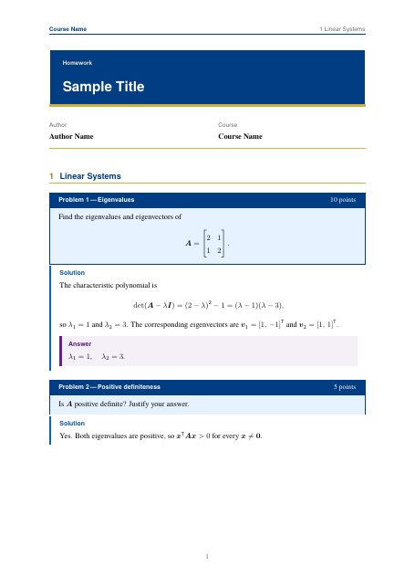 | 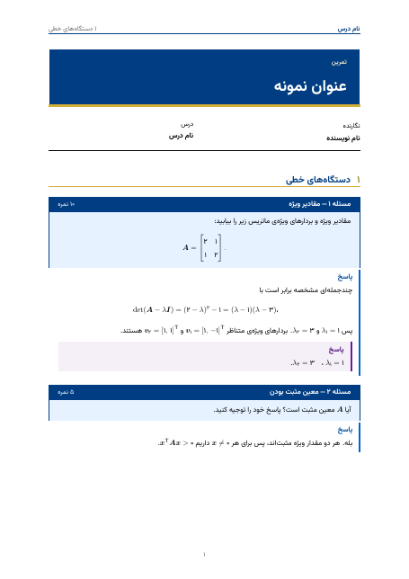 |
| **Lab report** | 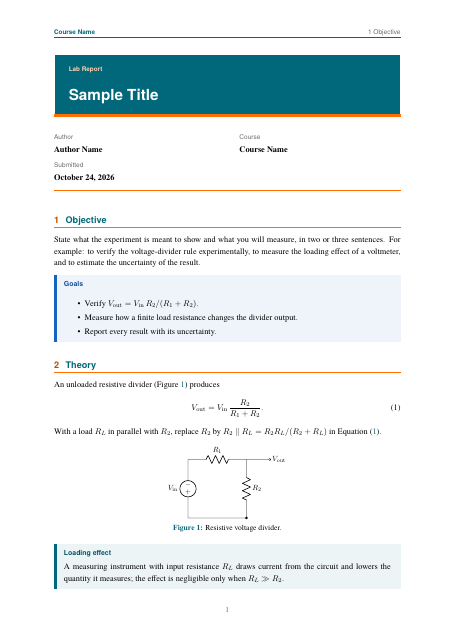 | 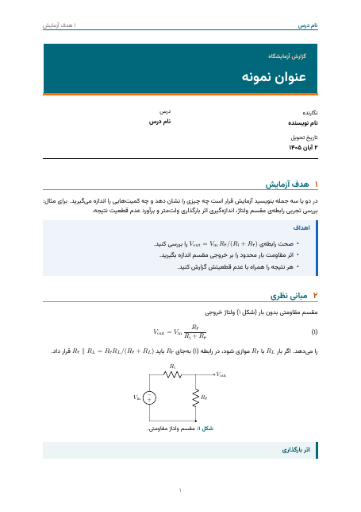 |
| **Project report** | 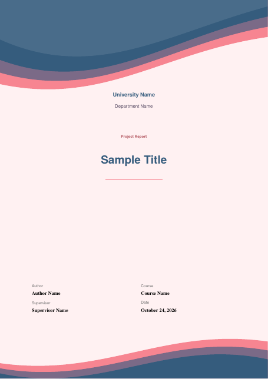 | 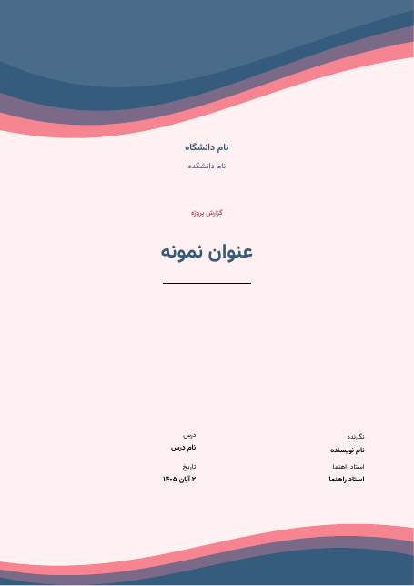 |
| **Formal report** | 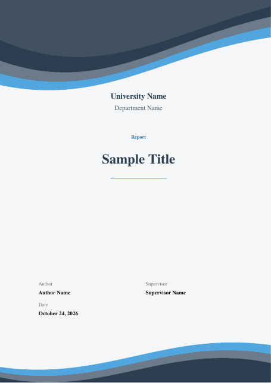 | 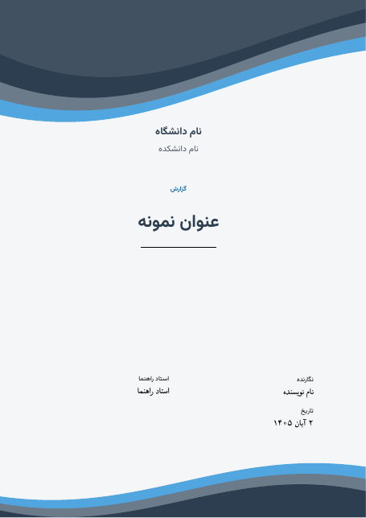 |
| **Essay** | 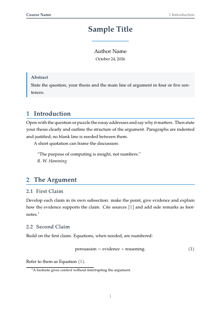 | 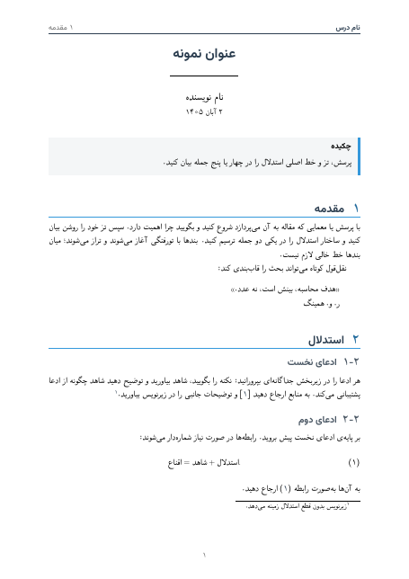 |
| **Paper** | 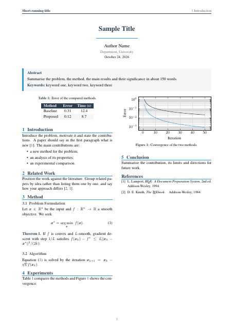 | 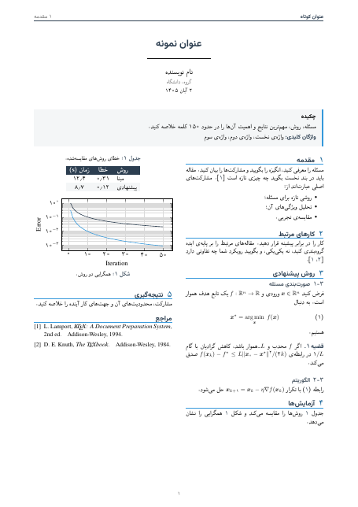 |

## Get started

**1. Install a TeX distribution** that includes XeLaTeX and `latexmk`:
[TeX Live](https://tug.org/texlive/) (Linux, Windows), [MacTeX](https://tug.org/mactex/) (macOS) or
[MiKTeX](https://miktex.org/) (Windows; `latexmk` needs Perl there). Or skip this and use [Overleaf](https://www.overleaf.com/).

**2. Download the generator** for your system from the
[latest release](https://github.com/MaximumAsp66915/AdvancedLatexTemplate/releases/latest). It is one file; nothing else to install.

| System | File |
|---|---|
| Windows (Intel/AMD) | `mktex-windows-amd64.exe` |
| Windows (ARM) | `mktex-windows-arm64.exe` |
| macOS (Apple silicon) | `mktex-macos-arm64` |
| macOS (Intel) | `mktex-macos-amd64` |
| Linux | `mktex-linux-amd64` or `mktex-linux-arm64` |

**3. Create a project.**

- **Windows**: double-click `mktex-windows-amd64.exe`, or run it in PowerShell. The program is not code-signed, so
  Windows SmartScreen may warn you: choose *More info*, then *Run anyway*.
- **macOS / Linux**: `chmod +x mktex-*`, then run `./mktex-macos-arm64` (or the Linux file). On macOS, if Gatekeeper blocks it,
  run `xattr -d com.apple.quarantine ./mktex-macos-arm64` once.

It asks for the language, the template, a folder name, a palette and the title-page details, then creates the project.
You can also give everything on the command line:

```bash
mktex -l fa -c lab-report -n lab3 -p ocean -s title="آزمایش ۳" -s author="نام" -y
mktex --list                  # templates, palettes, code themes
```

**4. Build it.**

```bash
cd lab3/latex
latexmk -xelatex main.tex     # produces main.pdf
```

The project also contains a VS Code setup (LaTeX Workshop) that builds with XeLaTeX. On Overleaf, upload the `latex/`
folder and choose the **XeLaTeX** compiler.

Prefer to build the generator yourself? With [Go](https://go.dev/dl/):
`go install github.com/MaximumAsp66915/AdvancedLatexTemplate/cmd/mktex@latest`.

## Templates

| Template | For |
|---|---|
| `homework` | problem sets: `problem` / `solution` boxes, code, results |
| `lab-report` | objective, theory, apparatus, procedure, data and plots, analysis, references |
| `project-report` | cover, abstract, contents, requirements, design, implementation, tests |
| `formal-report` | thesis, internship or final report: chapters, front matter, lists of figures and tables, appendices |
| `essay` | analytical prose with footnotes, quotations and references |
| `paper` | two-column research paper with abstract, keywords, theorems, IEEE-style references |

Every template exists in **both languages with the same structure**. Persian projects get right-to-left layout, Persian digits
and Jalali dates, and bundled Persian fonts (Vazirmatn, HM FElmi; SIL OFL), so they build on any computer.

**Palettes:** blue, red, gray, cyan, magenta, yellow, green, sunset, ocean, berry, neon.
**Code themes:** darcula, dark, bright, github. Change them in the project's `config.tex`
(`palette = sunset`, `listing = bright`) or mid-document with `\atlsetpalette{green}`.

## Documentation

| Read | When |
|---|---|
| [User manual](docs/USER-MANUAL.md) | creating projects, every setting, writing content, Persian rules, troubleshooting |
| [CONTRIBUTING.md](CONTRIBUTING.md) | you want to improve the templates |
| [AGENTS.md](AGENTS.md) and [docs/ai/](docs/ai/README.md) | AI coding agents (Claude, GPT/Codex, Gemini, ...) working on the repository |

## What is in this repository

| Folder | What it is |
|---|---|
| `templates/` | the catalog: `templates/<name>/en` and `fa` |
| `core/` | the engine (`atl/`), bundled fonts, files every project gets |
| `cmd/mktex/`, `go.mod`, `assets.go` | source of the generator (Go); it embeds `templates/` and `core/` |
| `docs/` | user manual, agent manual, preview images |
| `tools/` | maintainer scripts: checks, previews, release build (not needed to use the templates) |
| `.github/` | issue and pull-request templates |

## Contributing

The templates are free to use, and your documents are yours. If you improve them, please send the change back as a pull
request instead of keeping a private copy: it helps every student who uses the templates, in both languages.
See [CONTRIBUTING.md](CONTRIBUTING.md).

## License

[Mozilla Public License 2.0](LICENSE): free to use, including commercially. If you distribute modified copies of the files
in this repository, you must publish those changes under the same license (file-level, so your own documents are not
affected). The bundled Persian fonts keep their own license, SIL OFL 1.1 (see `core/fonts/`).
